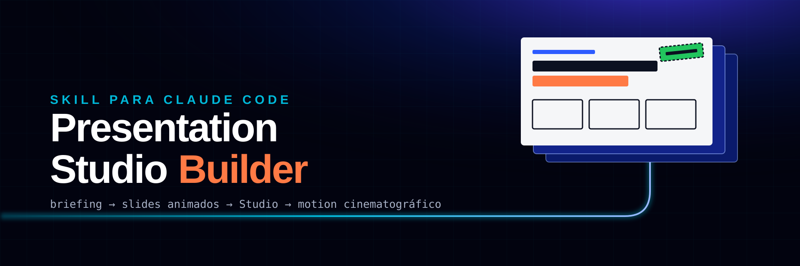

# Presentation Studio Builder

<p align="center">

  
</p>

<p align="center">
  
  
  
  
  
  
</p>

Skill do Claude para criar **apresentações HTML ao vivo de alto impacto visual** e **motion cinematográfico**, do briefing à entrega: narrativa em atos, direção de arte medida, slides como timelines GSAP com coreografia dirigida, player Studio para ritmo e narração para TTS.

O **Presentation Studio Builder** substitui sketches soltos e feedback em ping-pong por um pipeline estruturado de 10 etapas com portões de verificação. Cada slide é uma pequena animação dirigida (Problema → Feixe/Agente → Transformação → Big Number + Carimbo), validada deterministicamente. O método foi destilado de um projeto real de 25 slides em 7 atos, homologado ponto a ponto, e cada regra existe porque evitou um retrabalho.

---

## Fluxo de 10 Etapas

A skill conduz 10 etapas sequenciais com portões de verificação e loops fechados. Cada etapa lê apenas os guias de que precisa (divulgação progressiva).

```
┌─────────────────────────────────────────────────────────────────┐
│                 presentation-studio-builder (SKILL.md)          │
└────────────────────────────┬────────────────────────────────────┘
                             │
        ┌────────────────────┼────────────────────┐
        ▼                    ▼                    ▼
   ┌─────────┐         ┌──────────┐         ┌───────────┐
   │Briefing │         │Estrutura │         │ Direção   │
   │(Etapa 1)│         │  & Ledger│         │de arte(3) │
   └────┬────┘         │(Etapa 2) │         └─────┬─────┘
        └──────────────┴────┬─────┴────────────────┘
                             │
                    ┌────────▼────────┐
                    │  Scaffold (4)   │
                    │ Projeto offline │
                    └────────┬────────┘
                             │
                    ┌────────▼────────┐
                    │ Slides por ato  │◄────────────┐
                    │  (Etapa 5)      │             │ corrige
                    └────────┬────────┘             │
                             │                      │
                    ┌────────▼────────┐             │
                    │Validação (6)    │─────────────┘
                    │lint·capture·QA  │  loop até 100%
                    └────────┬────────┘
                             │
        ┌────────────────────┼────────────────────┐
        ▼                    ▼                    ▼
  ┌──────────┐       ┌────────────┐       ┌────────────┐
  │Studio(7) │       │Motion (8)  │       │Narração (9)│
  │ritmo/    │       │cinemato-   │       │roteiros    │
  │pausas    │       │gráfico opt.│       │TTS opt.    │
  └──────────┘       └────────────┘       └────────────┘
                             │
                    ┌────────▼────────┐
                    │ Auditoria (10)  │
                    │ números·fontes  │
                    └─────────────────┘
```

| Etapa | Responsabilidade | Guias acionados |
|-------|------------------|-----------------|
| **1 · Briefing** | Ocasião, duração, marca, resultados com fonte/estimativa, proibições; leitura 100% de documentos e errata | `01-discovery-and-brief` |
| **2 · Estrutura** | Atos, orçamento de tempo, ledger (1 slide = 1 ideia + 1–3 números max), fundo por conteúdo | `02-storytelling-and-structure` |
| **3 · Direção de arte** | Style bible: adjetivos, metáfora visual, paleta medida, material; temas claro/escuro/papel | `03-art-direction-and-themes` |
| **4 · Scaffold** | Projeto estático offline: engine, Studio, helpers, 3 slides de exemplo, fontes, GSAP/Three.js locais | `05-engine-and-studio` |
| **5 · Slides** | Cada slide é timeline GSAP pausada, em momentos (beats); coreografia Problema→Feixe→Transformação→Big Number | `04-motion-system`, `06-slide-authoring-guide` |
| **6 · Validação** | `lint-deck` (regras determinísticas), `capture` (imagens), `contact-sheet` (folha visual), console, navegação | `08-verification-and-qa` |
| **7 · Studio** | Pausas automáticas/manuais, trechos de velocidade, ocultar slide (numeração refeita), fundo por slide | `05-engine-and-studio` |
| **8 · Motion** *(opt.)* | Abertura cinematográfica: 3D em papel (Three.js), ilustração animada sobre arte ou vídeo de IA | `07-cinematic-intro-motion`, `11-motion-templates-and-licenses` |
| **9 · Narração** *(opt.)* | Um arquivo/slide, tempo-alvo, fala por momento, números extenso, "por que está na tela" | `09-narration-scripts` |
| **10 · Auditoria** | Números vs. fontes, navegação completa, rubrica final | `08-verification-and-qa` |

---

## Guias de Referência Integrados

A skill traz **12 guias de referência** e um exemplo de tema, lidos sob demanda pelo assistente:

| Guia | Propósito no fluxo |
|------|--------------------|
| `01-discovery-and-brief` | Perguntas do briefing, hierarquia de decisões, política de números, privacidade |
| `02-storytelling-and-structure` | Atos, orçamento de tempo, catálogo de tipos de slide, escolha de fundo |
| `03-art-direction-and-themes` | Style bible, tokens, três temas, papel recortado (estilo Vox), anti-clichê |
| `04-motion-system` | Coreografia, momentos (beats), propriedades permitidas, easings, padrões |
| `05-engine-and-studio` | Engine, preset v2, Studio, teclado, API de teste |
| `06-slide-authoring-guide` | Passo a passo de um slide, grade do palco, receitas visuais, armadilhas |
| `07-cinematic-intro-motion` | Árvore de decisão (3D em código, ilustração animada, vídeo de IA), cena aprovada |
| `08-verification-and-qa` | Lint, capturas, rubrica de qualidade, critério de parada, auditoria de números |
| `09-narration-scripts` | Formato, regras para TTS, tom, precisão das fontes |
| `10-lessons-learned` | Armadilhas técnicas e de processo já enfrentadas |
| `11-motion-templates-and-licenses` | Templates de motion, versões das bibliotecas, licenças e origem dos arquivos |
| `12-skill-maintenance` | Critérios de sucesso, avaliação (evals), empacotamento e versão |

---

## Pré-requisitos

- **Claude Code** com suporte a skills
- **Node.js ≥ 18** — para scripts de validação (`lint-deck`, `capture`, `contact-sheet`, `nav-test`)
- **Chrome ou Chromium** — para capturas e teste de navegação (*opcional: sem navegador, use só lint e revisão manual*)
- **Navegador moderno** — para abrir a apresentação gerada (HTML offline, sem CDN)

---

## Como começar

### O que você precisa antes de rodar

Um **briefing**: ocasião, duração, mensagem central, resultados esperados com fonte. Opcionalmente, uma pasta com documentos de contexto, guia de marca ou imagens de referência. A skill lê tudo antes de planejar.

### Instalação

```bash
# Clone o repositório
git clone https://github.com/brunotrolo-bank/Presentation-Studio-Builder.git
cd Presentation-Studio-Builder
```

### Para usar no Claude Code:

```bash
# Global (vale para todos os projetos)
cp -r presentation-studio-builder ~/.claude/skills/

# Ou por projeto
cp -r presentation-studio-builder <seu-projeto>/.claude/skills/

# Instale as dependências dos scripts (uma vez)
npm install --prefix ~/.claude/skills/presentation-studio-builder/scripts
```

No Windows, a pasta de skills pessoal é `C:\Users\<usuário>\.claude\skills\`. Reinicie a sessão do Claude Code ou rode `/reload-skills`; a skill carrega automaticamente ao solicitar uma apresentação, deck, motion ou narração. Se Chrome está fora do caminho padrão, defina a env var `CHROME_PATH`.

#### Para o claude.ai

Compacte a pasta `presentation-studio-builder/` em um `.zip` (com a pasta na raiz) e envie em **Configurações > Capacidades > Skills**. Nota: não há Chrome; use só lint e revisão manual.

---

## O que entra na sua pasta de skills

| Caminho | O que faz | Quando carrega |
|---|---|---|
| `SKILL.md` | Fluxo em 10 etapas, princípios, exemplos, solução de problemas e mapa de arquivos | Ao ativar a skill |
| `references/` | 12 guias detalhados e um exemplo de tema (marca de um banco) | Sob demanda, quando o fluxo indica |
| `assets/starter-kit/` | Projeto estático: palco 1920×1080, engine, Studio, helpers, 3 slides de exemplo, fontes, `lint.config.json` | Copiado pelo `scaffold.js deck` |
| `assets/motion-templates/` | `papercraft-3d-scene` (Three.js) e `image-pan-animation` | Copiado pelo `scaffold.js motion` |
| `assets/templates/` | Briefing, style bible, ledger de slides, narração, preset | Quando a etapa pede |
| `assets/vendor/` | `gsap.min.js` e `three.min.js` (uma cópia, copiada pelo scaffold) | Pelo scaffold |
| `scripts/` | `scaffold`, `lint-deck`, `capture`, `contact-sheet`, `nav-test` e `package.json` | Executados pelo assistente |
| `evals/` | 4 casos de teste, consultas de ativação e fixtures | Manutenção da skill |

Na raiz do repositório (não vai para a sua pasta de skills): este `README.md`, o `assets/banner.svg` e o `.gitignore`.

### Scripts

| Script | O que faz |
|---|---|
| `scaffold.js deck <pasta> "<Título>"` | Cria o projeto de apresentação (engine, Studio, slides de exemplo, GSAP local) |
| `scaffold.js motion <template> <pasta>` | Cria uma cena de motion a partir de um template |
| `lint-deck.js <pasta>` | Valida ids, timelines, momentos, marca-texto, preset, termos proibidos e números sem fonte; sai com código 1 se houver erro |
| `capture.js <index.html> <saida> all` | Congela cada slide em frações da timeline, salva PNG e acusa estouro de tela e erros de console |
| `contact-sheet.js <folha.png> <colunas> <imagens>` | Monta a folha de contato para revisão visual |
| `nav-test.js <index.html> [id]` | Testa setas, Home/End, voltar, ocultar slide e numeração do rodapé |

---

## Como a skill funciona internamente

### Fluxo com portões de verificação

#### Etapas 1–3: Briefing, estrutura e direção de arte
Fixa ocasião, duração, marca, resultados com fonte e proibições; trata a errata dos documentos como fonte que prevalece; monta o ledger (um slide por ideia, título com a mensagem, no máximo 1 a 3 números de destaque por caso, fundo escolhido pelo conteúdo) e o style bible com cores medidas de arquivos oficiais ou de imagens de referência.

#### Etapas 4–5: Scaffold e construção
O `scaffold.js deck` cria o projeto. Cada slide é um objeto `{ id, num, act, actName, actPage, title, theme, cls, html, build }`; `build(sec)` devolve uma timeline GSAP pausada, dividida em momentos por labels. Só `transform`, `opacity` e `stroke-dashoffset` são animados, e todo estado inicial fica dentro de `build`: o engine restaura o HTML e remonta o slide ao voltar no tempo.

#### Etapa 6: Validação (loop fechado)
A cada ato, na ordem: `lint-deck` → `capture` → `contact-sheet` → leitura das imagens → correção. Termina quando o lint não tem erros, as capturas não mostram defeitos e a rubrica fica ≥ 4. **Critério de parada:** após 3 ciclos sem melhora no mesmo slide, ou 2 rodadas com feedback vazio, a skill para e consulta o usuário, nunca em loop infinito.

#### Etapa 7: Studio (`index.html?studio`)
Linha do tempo arrastável com marcos numerados, pausas automáticas ou manuais em qualquer instante, trechos de velocidade, ocultar slide (numeração refeita) e fundo por slide (claro, escuro ou papel). A marcação é exportada em JSON e fixada em `js/preset-default.js`.

#### Etapa 8: Motion cinematográfico
Uma árvore de decisão escolhe o caminho: ilustração animada sobre arte do usuário (fiel à arte, sem mergulho 3D), cena 3D em papel com Three.js (offline, sem custo), ou vídeo de IA em frames. **Sempre uma amostra pequena antes de construir**, com aprovação da direção. O motion entra no deck como mais um slide de timeline.

#### Etapa 9: Narração
Um arquivo por slide, com tempo-alvo, fala por momento (números por extenso, sem símbolos que o TTS lê mal) e a seção "por que está na tela". A skill não inventa saudações nem contexto que as fontes não sustentam.

### Princípios que não mudam

| Princípio | Por quê |
|---|---|
| Verificar com imagens, não com a memória do código | Já houve slide "pronto" com marca-texto invisível e texto ilegível |
| Animar só `transform`, `opacity` e `stroke-dashoffset` | 60 fps no projetor e voltar no tempo sem sujeira |
| Fundo escolhido pelo conteúdo | Escuro para energia, claro para leitura, papel para dor e documento |
| Número com fonte; estimativa sinalizada; nunca somar casos | Estimativas inventadas foram rejeitadas por parecerem infladas |
| Sem texto em cenas 3D e sem mensagem negativa gratuita | Cards flutuantes e alertas em texto foram reprovados |
| Consultar antes de gastar, publicar ou apagar | Créditos de geração, deploy e exclusão exigem aprovação explícita |

### Ciclo por execução

```
briefing + documentos + guia de marca
        ↓
Briefing: lê 100% dos arquivos, trata a errata como fonte que prevalece
        ↓
Ledger de slides + style bible (cores medidas)
        ↓
scaffold.js deck → projeto offline (engine + Studio)
        ↓
Slides por ato → lint-deck → capture → contact-sheet → leitura das imagens
        ↓                                              (loop até lint sem erros e rubrica ≥ 4)
Studio: pausas, velocidade, ocultar, fundo → preset-default.js
        ↓
(opcional) Motion de abertura · (opcional) Narração por slide
        ↓
Entrega: projeto + o que foi verificado e o que não foi + decisões tomadas sem consulta
```

Uma entrega só é "concluída" quando o lint passa sem erros, a navegação passa no `nav-test` e a resposta diz, sem inflar, o que foi e o que não foi verificado.

---

## Validação aplicada

| Ciclo | Foco | Resultado |
|-------|------|-----------|
| 1 | Starter-kit em Chrome headless | 3 slides carregados, durações lidas, sem estouro, sem erros de console |
| 2 | Navegação (`nav-test`) | Setas, Home/End, voltar, ocultar slide e numeração do rodapé aprovados |
| 3 | `lint-deck` com falhas plantadas | Detectou número duplicado, marca-texto sem animação, termo proibido, preset e momento inexistentes |
| 4 | Dependências dos scripts | Mensagens acionáveis para `puppeteer-core` e Chrome ausentes; instalação em `scripts/` validada |
| 5 | Conformidade com o guia de skills da Anthropic | Frontmatter validado com parser YAML (descrição de 818 caracteres, só campos portáveis); sem README dentro da skill; caminhos com `${CLAUDE_SKILL_DIR}`; `evals.json` no formato oficial |
| 6 | Avaliações com e sem a skill (casos 3 e 4) | Aprovação de 100% com a skill e 92% sem; a skill muda sobretudo o formato da entrega; custo de cerca de 7 mil tokens e 68 s a mais |

Limites declarados: os casos 1 (deck completo) e 2 (cena 3D) dos evals não foram executados; cada caso rodou uma vez e foi corrigido pelo próprio autor; não houve teste com outros modelos; o movimento fluido e o desempenho das cenas 3D não foram medidos em hardware real.

---

<p align="center">
  ⭐ <b><a href="https://github.com/brunotrolo-bank/Presentation-Studio-Builder/stargazers">Dê uma star no repo</a></b> para ser avisado quando novos templates e melhorias saírem.
</p>

---

## Resumo — input, o que faz, o que entrega

| | |
|---|---|
| **Input** | Um briefing (ocasião, duração, mensagem central) e, opcionalmente, uma pasta de documentos, um guia de marca e imagens de referência. A skill lê tudo antes de planejar. |
| **O que faz** | Conduz 10 etapas com portões de verificação: 1) **Briefing** e fontes de verdade; 2) **Estrutura** em atos e ledger; 3) **Direção de arte** com style bible; 4) **Scaffold** offline; 5) **Slides** como timelines GSAP; 6) **Validação** determinística e visual; 7) **Studio** para ritmo; 8) **Motion** cinematográfico opcional; 9) **Narração** opcional; 10) **Auditoria** de números e navegação. |
| **Entrega** | Uma pasta de apresentação pronta para abrir (`index.html` e `index.html?studio`), ledger e style bible, relatório de validação (o que foi e o que não foi verificado), decisões tomadas sem consulta e, se pedidos, a cena de motion e a pasta `narracao/`. |

---

## Licença e terceiros

Código e documentos da skill: **MIT**. As bibliotecas e fontes incluídas têm origem e licença registradas em [`presentation-studio-builder/references/11-motion-templates-and-licenses.md`](presentation-studio-builder/references/11-motion-templates-and-licenses.md): GSAP (licença padrão da GreenSock), Three.js r152 (MIT), Poppins e JetBrains Mono (SIL OFL). O fundo de papel é gerado por CSS/SVG, sem imagem de terceiros.
